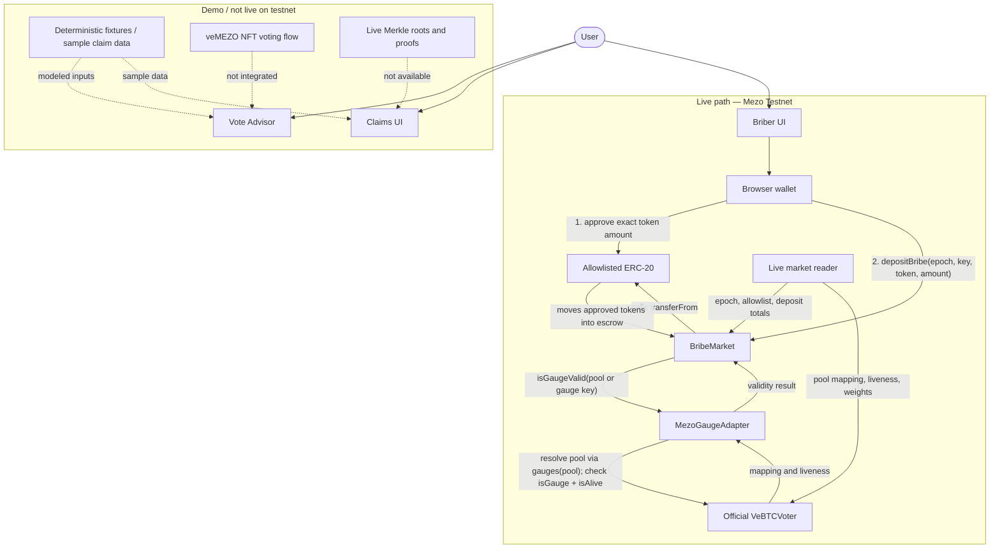

# MezoBribe

[](https://github.com/IdcuqS07/mezo-bribe/actions/workflows/ci.yml)

> **Status:** Experimental Mezo Testnet project. The contracts have not been audited and are not production-ready.

MezoBribe is a bribe marketplace and Vote Advisor for veMEZO gauges. It helps bribers direct MUSD/MEZO incentives toward pools that need liquidity, then helps voters allocate veMEZO weight while accounting for expected income and vote dilution.

## Quick start

Requirements: Node.js `>=22.12.0` and npm. Foundry is required for contract checks.

```bash
npm ci
npm run dev
```

The frontend is served at `http://127.0.0.1:3000`.

## System flow

Solid arrows represent live testnet reads or transactions. Dashed arrows identify demo or not-yet-integrated paths.



## Checks

Run the same checks used by GitHub Actions before opening a pull request:

```bash
npm run typecheck
npm test
npm run build
forge fmt --check
forge build
forge test -vv
```

The CI workflow runs frontend checks on Node.js 22 and 24 and Solidity formatting/build/tests. It is read-only and never broadcasts deployment transactions.

## What can be demonstrated

The market board displays the current epoch, DEX/token filters, clearing prices, vote counts, and historical signals. Gauge detail pages provide deposit previews. Vote Advisor uses deterministic fixture data and a water-filling algorithm to calculate allocations that account for the user's own vote dilution. Lock and exclude controls can be changed to recalculate the recommendation. Claims provides a local batch-claim flow with root status, dust, proofs, and history. The Briber workspace compares cost per vote and models the impact of a top-up. The Verification room explains roots, leaves, formulas, and keeper commands.

The frontend supports browser-wallet connections to Mezo Testnet and live deposits through two sequential transactions: an exact ERC-20 approval followed by `BribeMarket.depositBribe`. Runtime market state is read directly from the deployed BribeMarket contract (`epochs`, `allowedToken`, `minimumDeposit`, and `bribeTotal`). The official testnet `VeBTCVoter` at `0x72F8dd7F44fFa19E45955aa20A5486E8EB255738` has been verified by direct RPC reads; the reader resolves pool addresses to live gauges and reads gauge liveness and weights. The previously referenced mainnet `PoolsVoter` address `0x48233cCC97B87Ba93bCA212cbEe48e3210211f03` has no bytecode on chain `31611` and is not used. Signature voting and claims remain in **Demo mode** because this deployment exposes a VeBTC voter (not a verified veMEZO NFT voting flow) and live roots/proofs are not yet available. If an epoch has not been configured on-chain, the UI rejects a deposit before requesting token approval.

## Mezo Testnet deployment

- Network: Mezo Testnet, chain ID `31611`
- RPC: `https://rpc.test.mezo.org`
- Explorer: `https://explorer.test.mezo.org`
- BribeMarket: [`0xe378E93D5eC4dDa719355c5274d85e97c3a0A500`](https://explorer.test.mezo.org/address/0xe378E93D5eC4dDa719355c5274d85e97c3a0A500)
- Testnet MUSD: [`0x118917a40FAF1CD7a13dB0Ef56C86De7973Ac503`](https://explorer.test.mezo.org/address/0x118917a40FAF1CD7a13dB0Ef56C86De7973Ac503)
- Testnet MEZO: [`0x7B7c000000000000000000000000000000000001`](https://explorer.test.mezo.org/address/0x7B7c000000000000000000000000000000000001)

Deployment metadata and receipts are recorded in [`deployments/mezo-testnet.json`](deployments/mezo-testnet.json). The adapter `0x9E3439387B685FD4731Fdc7b3382B3348C03998a` was deployed and configured in block `16379346`; pool-to-gauge and direct-gauge validation were checked through RPC. Dynamic epoch and market values below are a snapshot verified on `2026-10-26`; query the chain before relying on them.

At that verification time, the owner, publisher, and guardian were `0x7119d53f0241F16c96b521ccF862473e18a29d6b`; MUSD and MEZO were allowlisted with a minimum deposit of `100` tokens; the dispute window was `86400` seconds; and epoch 42 was open until `2026-10-28 12:15:25 UTC`. The voter resolved the MUSD/BTC pool to `0xeF07B6852f4F877fB3BBD90b8f358Fb3E07D0Cc3` and the MUSD/mUSDC pool to `0x57Ebd7aFD11923082454689975Ea592C7Ed219a0`, both alive at verification time. The adapter deployment transaction is `0x6df52be1e25194dce3cfa3d08640a56517702a533d78a484c667587bb4c86756`; `setGaugeAdapter(address)` was called in transaction `0x7330ae76f6b683d88190407c01c400023d296bddc00fff294e573fea75fca115`. The target mainnet chain ID is `31612`; this testnet deployment does not imply mainnet readiness.

## Advisor formula

For gauge `g`, `B(g)` is the total USD value of bribes, `V(g)` is the current vote count, and `v(g)` is the user's vote allocation. Estimated income is:

```text
income(g) = B(g) × v(g) / (V(g) + v(g))
```

Water-filling selects the gauge with the highest marginal income until the full veMEZO weight is allocated. A locked gauge receives a minimum share, while an excluded gauge never receives an allocation. APY is estimated as `income per epoch × 365 / epochDays`, divided by a reference lock value; it is not a guarantee of returns.

## Architecture

`src/domain` contains UI-independent types, test fixtures, and calculators. `src/adapters/bribeMarketReader.ts` reads the live epoch, token configuration, bribe totals, pool-to-gauge mappings, liveness, and weights from BribeMarket and the Mezo Testnet VeBTCVoter through the Mezo RPC. `src/adapters/mezoGaugeAdapter.ts` records the verified testnet adapter configuration; `src/adapters` also defines boundaries for Mezo gauges and wallet connectivity. `src/App.tsx` provides lightweight routing, read-only on-chain state, review modals, and the Market, Gauge, Advisor, Claims, Briber, and Verify pages. `public/manus-routes.json` declares all application routes. Keeper/indexer operations, verified veMEZO NFT voting, root publishing, and live claims remain follow-up work.

## Security and limitations

MezoBribe does not custody veMEZO, request NFT or lock-transfer approvals, issue a new token, operate a DEX, provide KYC or tax services, or guarantee returns. The initial displayed tokens are MUSD and MEZO. The live reader intentionally shows an empty market when no verified testnet gauge registry is configured rather than substituting mock rows. The testnet contract includes token allowlisting, checks-effects-interactions, a reentrancy guard, a dispute window, guardian pause controls, and unit tests. Fuzz/invariant tests, an audit, production deployment verification (including the adapter), live voting/claims, and production epoch-window operations remain before production use. A live refund transaction for an invalid gauge has not been exercised.

See [SECURITY.md](SECURITY.md) for vulnerability reporting and [CONTRIBUTING.md](CONTRIBUTING.md) for development and pull request guidelines.

## License

No repository-wide license has been selected. Individual source files may contain SPDX notices; those notices do not establish a license for the entire repository. Confirm with the maintainer before redistributing files without an explicit license.
